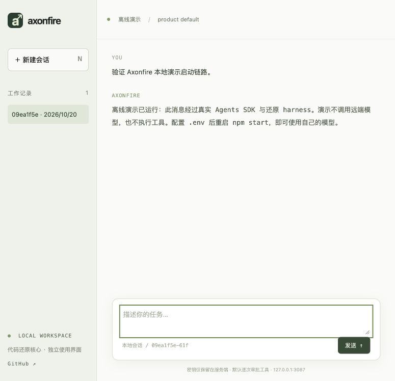

# axonfire-harness

基于本机 WorkBuddy 5.3.14 样本、逐模块恢复的 Agent Harness。保留 OpenAI Agents SDK 依赖，并提供开箱即用的本地 CLI 与 Web 工作台。

> 这是进行中的代码还原项目，不是官方 WorkBuddy，也不宣称已 100% 还原全部产品逻辑。Web UI 是新增的独立宿主，不是原版界面。已还原部分、证据和剩余边界见 [还原状态](docs/recovery-status.md)。

最新阶段恢复完整 ACP Agent/View/团队桥/增量解析器及依赖声明，并通过原样本 AST 与行为差分；真实 SDK 已验证其工具/文本转发和历史重放。完整 RPC、广播和审批 owner 尚未接管默认入口，见 [ACP 协议核心边界](docs/acp-protocol.md)。CLI/Web 的开箱即用入口保持不变。

标题、friction/召回、广播与 usage 源服务也已恢复；完整 AcpView 执行链通过真实 SDK 集成，附有独立的订阅/定时器/异步任务宿主。其默认入口和外部服务边界见 [ACP 服务说明](docs/acp-services.md)。

ACP 连接/Stream/guard 的 10 个完整类及样本修改版 ACP SDK 已恢复，通过完整 AST、原样本行为差分和真实本地 stdio/HTTP 双向传输测试；尚未接管默认业务/审批入口，见 [ACP 连接说明](docs/acp-connections.md)。OpenAI SDK 仍保留原依赖，不重新实现。

## 快速开始

需要 Node.js **22.19+** 和 npm。无需安装原版应用。

```sh
git clone https://github.com/cFireworks/axonfire-harness.git
cd axonfire-harness
npm ci
npm run build
npm run demo
```

打开 **http://127.0.0.1:3080**。离线演示无需密钥：经过真实 SDK 与还原 harness，但使用固定模型回复，不访问远端或执行工具。

使用自己的模型：

```sh
cp .env.example .env
# 编辑 .env，填写 OPENAI_API_KEY、OPENAI_BASE_URL、CODEBUDDY_MODEL
npm start
```

模型接口为 **OpenAI-compatible Chat Completions**，必须显式配置地址。不会读取已安装 WorkBuddy 的账户、令牌或聊天记录。密钥只在本地服务端使用，不发送给浏览器。不要把 `.env` 提交到仓库。

CLI 使用同一核心：

```sh
npm run cli -- --help
npm run cli -- --cwd /absolute/path/to/project
npm run cli -- -p "了解这个项目" --cwd /absolute/path/to/project
# 非交互模式只允许明确批准的工具，例如：
npm run cli -- -p "读取 README.md" --allow-tools Read --cwd /absolute/path/to/project
# 显式加载可信本地插件；可重复 --plugin-dir
npm run cli -- --plugin-dir /absolute/path/to/plugin --cwd /absolute/path/to/project
# Web 同样支持该参数：npm start -- --plugin-dir /absolute/path/to/plugin
# CLI / Web 共用原设置加载器，none 排除磁盘作用域但仍应用 CLI JSON：
npm run cli -- -p "你好" --setting-sources none --settings '{"reasoningEffort":"high"}'
# Web：npm start -- --setting-sources user,project,local --effort high
# 可选：使用自己有权使用的可信资源根目录（包含 plugins/workbuddy-builtin）
npm run cli -- --builtin-assets /absolute/path/to/resources --cwd /absolute/path/to/project
# Web 同样支持：npm start -- --builtin-assets /absolute/path/to/resources
```

Web 工具调用逐次审批，支持流式回复、历史恢复、取消、上下文压缩和 Agent 问答。会话默认保存在工作目录的 `.axonfire/`；CLI 兼容原 standalone 宿主的 `.workbuddy-harness/`。这些目录均被 Git 忽略。

## 仓库结构

借鉴 [deepseek-harness](https://github.com/deepseek-ai/deepseek-harness) 的应用 / 核心包 / 文档分层；不引入其插件框架、不替换已还原逻辑。

```text
apps/
  cli/                   axonfire 启动器：CLI / Web
  web/                   本地 HTTP + SSE 宿主、静态工作台、宿主测试
packages/
  harness/
    src/                 还原核心及明确标记的 standalone adapters
    config/              固定样本配置与原始 prompt
    test/                核心回归测试
    scripts/             配置校验 / 原样本 AST 与行为差分
docs/                    还原报告、历史批次、使用与架构边界
scripts/                 仓库级验证入口
```

没有把核心拆成大量空包；原模块之间的相对路径、配置读取和依赖版本保持稳定。SDK 版本固定为 `@openai/agents* 0.5.2`、`openai 6.25.0`，不重新实现 SDK。

## 验证

```sh
npm run check
npm test
npm run smoke:runtime
npm run smoke:launchers
npm run verify:config
# 可选：需要固定 SHA 的 CLI bundle 与 Desktop main 目录，不随仓库分发
npm run verify:recovery -- /absolute/path/to/codebuddy.js
# main 不在原 app 布局时设置 WORKBUDDY_DESKTOP_MAIN=/absolute/path/main/index.js
# 会话Addon额外样本可用 WORKBUDDY_DESKTOP_INITIALIZE、WORKBUDDY_MODE_COORDINATOR 指定
```

最新验证数据见 [还原状态](docs/recovery-status.md)末尾。原 ProductManager 默认驱动配置合并、动态 provider 与 Agent/命令刷新；原文件/模型 providers、企业策略、PluginManager 的本地插件加载与跨服务刷新现已接入。本地/Git/HTTP/ZIP 市场、配置持久化/修复、更新检查与文件锁已接入；真实 SDK 从远端 ZIP 安装到版本缓存并重启恢复 Agent/命令通过自有服务验证。CLI/Web 可直接执行 `/reload-plugins`，本地命令不发送给模型。独立 Git/npm/subdir 安装器、原插件选项存储与错误收集也已接入。原磁盘 SettingsManager、CLI 设置/作用域加载队列和 PluginPolicy 现为默认路径，支持插件启停/卸载持久化、JSONC 与 ConfigChange Hook；内置资源物化、七级资源解析、PluginController/Validator 和 seed 元数据交接现已接入显式可信资源目录。资源包内的第三方程序不随仓库分发，Cloud product 的账户门槛、用户缓存、退避重试及配置合并现已默认接入，HTTP/认证仍需显式 adapter，不读取原应用账户。会话 Addon/mode 核心及每会话独立后端现有嵌入接口；原资源PromptService、九collector与22份Desktop模板/风格文本现已移植并接入Addon变量/CLI语言；完整UserPromptService与17个section已提供独立ACP组合宿主；Addon新增显式promptAcp入口，已接原meta/首轮核心及ACP→SDK转换；完整SessionManager/RPC/回放控制、daemon/Electron bootstrap与自动模式重启仍待恢复。完整权限服务和原审批控制器通过 `nativePermissions`、`nativeApprovals` 显式使用；`sdkControl` 或 `nativeMcp` 默认启用这两条 native 路径及原生 MCP 宿主。权限/MCP/SDK 设置消费者现已按原 scope 接回 SettingsManager；权限规则与 MCP 批准可重启恢复，SDK 模型选择仍为进程内 CLI 状态；CLI/Web 默认仍保留兼容审批宿主，原环境切换、环境JSON/endpoint providers现已默认接入；真实 Auto classifier、完整登录/鉴权和其余bootstrap仍待恢复。配置中的115个原始product prompt和固定哈希不变；新增22份Desktop文本独立逐字节校验。详细边界见 [还原状态](docs/recovery-status.md)，配置与启动验证见 [使用说明](docs/getting-started.md)。

本地工作台演示：



## 范围与安全

这是有本地文件 / Shell 能力的开发工具，**审批不是操作系统沙箱**。只在可信工作目录运行；不要审批不了解的命令。Web 固定监听 `127.0.0.1`，检查 Host、Origin 和 CSRF token，不提供公网部署、多用户认证或远程访问。不要直接通过反向代理暴露。

只加载可信插件和设置：插件或作用域配置可以包含自动执行的 Hook；Hook 命令不等同于逐次模型工具审批。默认不扫描已安装 WorkBuddy 的插件或账号；默认内置市场为空，仅根据你显式配置的市场/启用标志/策略安装插件。`--setting-sources none` 排除合并视图中的磁盘 scope，但原权限/MCP显式分 scope 查询仍可能读取磁盘；它不是禁止所有读写的沙箱，也不排除显式 CLI 设置/插件。

仓库不包含安装包、完整原始 bundle、个人凭据和运行记录。配置/还原片段来自分析样本；不能据此认定其全部拥有可重新授权的开源许可证。仅在你有权使用的范围内研究、验证和使用，保留依赖自身的许可证与通知。

锁定依赖当前有 **17 项 npm audit 告警**（10 中危、7 高危），未做改变还原行为的强制升级。本批按样本新增的 `yauzl 3.2.0` 带有 [NTFS 时间戳解析告警](https://github.com/advisories/GHSA-gmq8-994r-jv83)；只加载可信市场/归档，不能把本项目当作安全解包服务。原生 MCP 独立依赖固定为 `@modelcontextprotocol/sdk 1.24.3`，不替换 OpenAI SDK 自身的传递依赖。

- [启动说明与故障排查](docs/getting-started.md)
- [核心还原详细说明（历史命令以新目录为准）](docs/reconstruction.md)
- [逐模块还原状态与未恢复边界](docs/recovery-status.md)
- [架构与宿主边界](docs/architecture.md)
